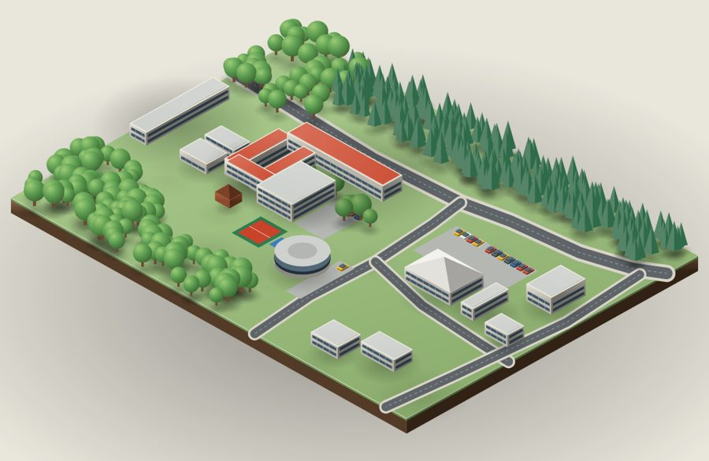
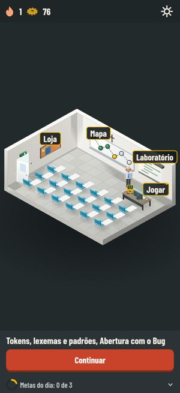
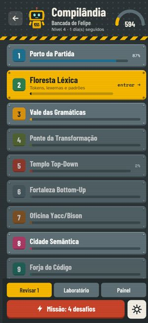
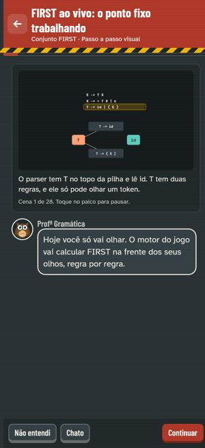
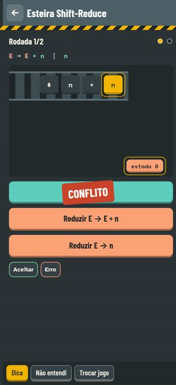
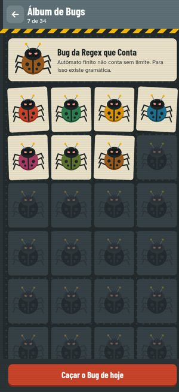
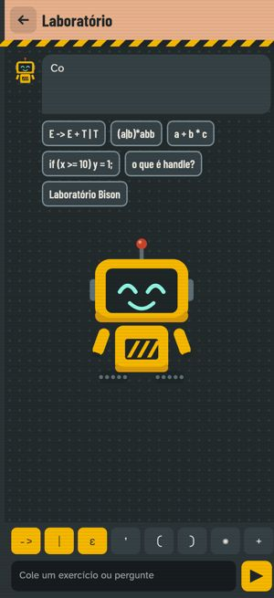
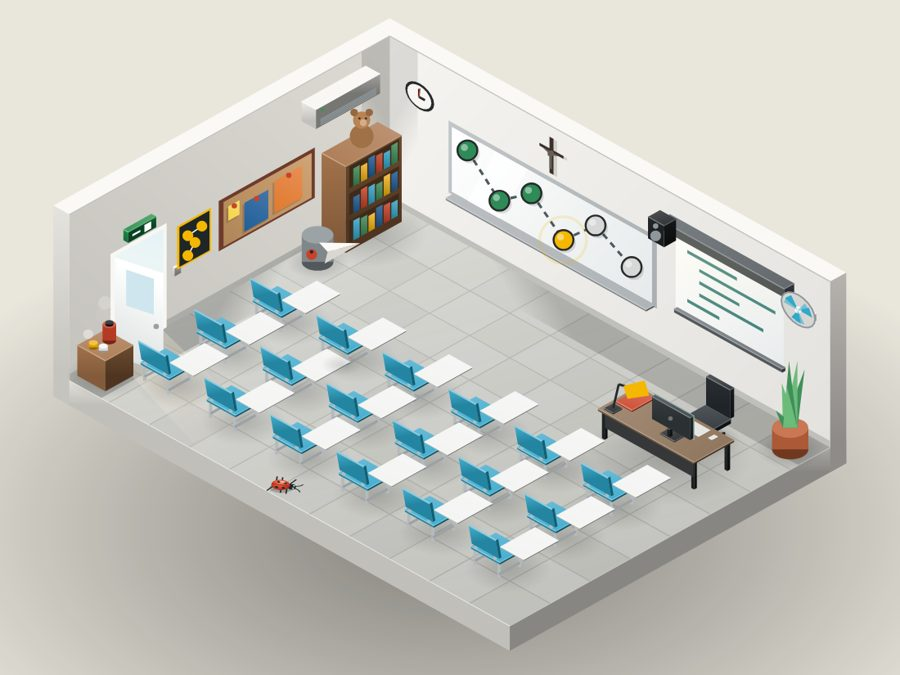

<div align="center">

# Compilândia

**Aprenda Compiladores jogando.**

Um jogo para quem acha que "não é bom em compiladores": aulas animadas com voz, 29 minijogos e um motor de compiladores de verdade gerando cada exercício. Funciona offline, no celular, no computador e no navegador.

[](https://fgcl.github.io/Compilandia/)
[](https://github.com/fgcl/Compilandia/raw/main/builds/Compilandia-1.0.apk)
[](https://github.com/fgcl/Compilandia/raw/main/builds/Compilandia-1.0.jar)

[](LICENSE)
[](docs/LICENCA-CONTEUDO.md)




</div>

---

## Sumário

- [Baixar e jogar](#baixar-e-jogar)
- [Telas](#telas)
- [O que tem dentro](#o-que-tem-dentro)
- [Como o jogo ensina](#como-o-jogo-ensina)
- [Para quem programa](#para-quem-programa)
- [Licença, créditos e aviso legal](#licença-créditos-e-aviso-legal)

## Baixar e jogar

| Onde | Como |
|---|---|
| **Navegador** | Abra <https://fgcl.github.io/Compilandia/>. O progresso fica salvo no próprio navegador. |
| **Android** (7.0 ou mais novo) | Baixe o [Compilandia-1.0.apk](https://github.com/fgcl/Compilandia/raw/main/builds/Compilandia-1.0.apk), abra o arquivo no celular e permita "instalar de fontes desconhecidas". |
| **Windows, Mac ou Linux** | Baixe o [Compilandia-1.0.jar](https://github.com/fgcl/Compilandia/raw/main/builds/Compilandia-1.0.jar) e rode `java -jar Compilandia-1.0.jar` (precisa do [Java 17](https://adoptium.net) ou mais novo). Na pasta [`builds`](builds) há atalhos para Windows e Mac/Linux. |

> [!NOTE]
> Os arquivos da pasta `builds` são a versão 1.0. A versão mais nova do APK sai a cada push: aba **Actions** → **Build APK** → artefato **compilandia-apk**. O site é publicado de novo a cada push na `main`.

O jogo não pede conta, não tem anúncio e não usa internet. Em inglês, as falas aparecem escritas, sem voz.

## Telas

<p align="center">
  
  
  
  
  
  
</p>

<p align="center"></p>

## O que tem dentro

O conteúdo segue a disciplina de **Compiladores** da PUC Minas e a base de gramáticas e autômatos de **FTC**. O mapeamento está em [docs/CURRICULO.md](docs/CURRICULO.md).

### O campus e a sala de aula
Ao abrir o jogo, o campus da PUC em Poços de Caldas aparece visto de cima, e a câmera desce até a sala de aula. Na sala, cada móvel abre um lugar:

| Móvel | Abre |
|---|---|
| Quadro branco | o **Mapa** de aulas |
| Computador da mesa do professor | **Jogar** |
| Tela de projeção | o **Laboratório** |
| Mural | a **Loja** |

Jogar rende engrenagens, e cada engrenagem compra uma peça para a sala. O botão **Continuar** sempre sabe o próximo passo.

### Aulas animadas com voz
Cada um dos 29 assuntos tem uma aula em que o algoritmo roda no palco e o Byte narra, com a boca sincronizada com a fala. Toda aula segue o mesmo caminho: por que o assunto existe, um exemplo, a receita, e um segundo exemplo em que você responde. No fim, o Bug lança um desafio e a professora fecha com um resumo.

- A aula abre com o Bug: 10 segundos para tentar antes da explicação.
- A animação para e pede o seu toque no próprio desenho.
- **Não entendi** em cada fala, legenda (CC), fita de cenas para voltar e **Outro exemplo** gerado na hora.

### A trilha de cada assunto
Abertura com o Bug → aula animada → fazer com ajuda (o Byte ajuda cada vez menos) → programar o Byte → prática → pegadinha → desafio. Qualquer etapa pode ser pulada.

### E mais
- **29 minijogos**, de fatiar tokens a montar MIPS, todos gerados pelo motor.
- **Bancada do Byte:** você programa um robô em seis assuntos e vê onde ele quebra.
- **Laboratório:** cole uma gramática, regex, expressão ou arquivo `.y` e o Byte diz o que é e roda passo a passo.
- **Laboratório Bison:** precedência que se arrasta, pilha passo a passo e os conflitos explicados.
- **Álbum de Bugs:** 34 erros comuns de prova viram figurinhas.
- **Corrida**, **Desafio do dia** (um Wordle de gramáticas), **30 segundos**, **chefões** e **data da prova**.
- **Guia do Trabalho Prático**: um compilador completo, do léxico ao MIPS.
- **Fábrica de Gramáticas:** um jogo de automação em que cada máquina no chão é uma regra da gramática.

<details>
<summary><b>Fábrica de Gramáticas</b></summary>

Um jogo de automação no jeito do Mindustry em que **a fábrica é a gramática**: cada máquina no chão é uma regra que você escolhe, e a gramática do Laboratório é a soma delas.
Uma caixa (letra) segue as esteiras até o separador, que manda para a máquina da regra; a máquina abre a caixa e as fichas da regra saltam para fora; as peças vão para a impressora, que monta a frase.

- **Menu de construção e loja:** Mover, Esteira e Apagar no alto; embaixo, os blocos por aba. Braço e Armário se compram com engrenagens.
- **Esteira cruzando esteira** vira junção sozinha, como no Mindustry.
- **Tutorial de 8 missões** (as duas últimas pedem escolher a regra e construir a máquina) e 6 desafios com estrelas.
- Arquitetura, regras do desenho e a receita para criar bloco novo em [docs/FABRICA.md](docs/FABRICA.md).
</details>

<details>
<summary><b>Os 29 minijogos</b></summary>

| Jogo | Mecânica | Assunto |
|---|---|---|
| Esteira das Fases | montar o pipeline | fases do compilador |
| Detetive de Erros | contra o relógio, quem pega o erro? | léxico × sintático × semântico |
| Fatiador de Tokens | cortar a linha e classificar | tokens, maior casamento |
| Trem do Autômato | pilotar o AFD estado a estado | regex/AFD |
| Porteiro Regex | deixar entrar quem casa | expressões regulares |
| Derivação Turbo | escolher produções e ver a árvore crescer | derivação mais à esquerda |
| Duas Árvores | provar ambiguidade | ambiguidade |
| Cirurgia de Gramática | montar a gramática com peças | recursão à esquerda, fatoração |
| Alquimia FIRST/FOLLOW | ingredientes nos caldeirões | FIRST, FOLLOW |
| Sudoku LL(1) | preencher a tabela preditiva | tabela LL(1) |
| Torre da Pilha | operar o analisador preditivo | LL(1), descida recursiva |
| Esteira Shift-Reduce | empilhar ou reduzir | shift-reduce, SLR |
| Construtor de Estados | closure e goto | itens LR(0) |
| Caça-Conflitos | achar conflitos e resolvê-los como o Bison | SLR, LALR, precedência |
| Oficina Bison | programar um `.y` até os testes passarem | Yacc/Bison |
| Árvore Anotada | calcular tipos de baixo para cima | atributos, tipos |
| Esconde-Esconde do Escopo | ligar cada uso à declaração | tabela de símbolos |
| Linha de Montagem TAC | montar código de três endereços | código intermediário |
| Fábrica de Subconjuntos | juntar estados do AFN | AFN → AFD |
| Oficina Flex | ordenar as regras do `.l` | Lex/Flex |
| Sala do Pânico | onde o erro é detectado e onde o parser se recupera | recuperação de erros |
| Pilha de Chamadas | registros de ativação | ambientes de execução |
| Montadora MIPS | traduzir TAC para MIPS e rodar | geração de código |
| Programador Descendente | montar o método do parser | descida recursiva |
| Fábrica de Autômatos | montar o autômato com o dedo | regex/AFD, minimização |
| Tabela dos Pares | marcar pares distinguíveis e juntar estados | minimização de AFD |
| Fábrica de AST | montar a AST com `new BinOp(...)` | árvore sintática abstrata |
| Coloração de Registradores | vivacidade e grafo de interferência | alocação de registradores |
| Labirinto de Desvios | completar os desvios do if/while e rodar no MARS | geração de código |

Nove jogos de classificar terminam com **Agora roda**: o motor executa o que você respondeu.
</details>

<details>
<summary><b>O motor de compiladores</b></summary>

Tudo é gerado pelo motor do próprio jogo (`composeApp/src/commonMain/kotlin/com/compilandia/engine`), então a prática não acaba:

- FIRST/FOLLOW com rastro passo a passo;
- tabelas LL(1), LR(0), SLR(1), LR(1) e LALR(1), e Earley;
- Thompson, subconjuntos e minimização de AFD;
- um mini-Bison com `%left`, `%right`, `%nonassoc`, `%prec` e ações `$$ = $1 + $3`;
- simulador MIPS.
</details>

## Como o jogo ensina

- **Prática de recuperação** e **repetição espaçada** (curva de esquecimento estilo FSRS), com a revisão mudando de formato a cada vez.
- **Intercalação**, **efeito de geração** ("preveja antes de ver") e **metacognição**: antes de cada jogo você diz sua confiança e depois vê o espelho confiança × resultado.
- **Modelo do aluno no aparelho:** BKT, uma rede MLP pequena treinada online e Thompson Sampling escolhem os desafios na faixa de ~75% de acerto. Nada sai do celular.
- **Dica em três degraus:** aponta o lugar, diz por quê e só depois mostra resolvendo.

As fontes de cada decisão estão em [docs/PESQUISA.md](docs/PESQUISA.md).

**Conforto:** cinco temas (claro, sépia, escuro, noite âmbar e alto contraste), tamanho do texto, reduzir animações, legenda, Português ou English, e arranjo próprio para tela larga e celular deitado.

## Para quem programa

Kotlin Multiplatform + Compose Multiplatform, com alvos Android, desktop (JVM) e navegador (Kotlin/Wasm).

```bash
./gradlew :composeApp:run                       # versão para computador
./gradlew :composeApp:assembleDebug             # APK (precisa do Android SDK)
./gradlew :composeApp:wasmJsBrowserDistribution # site
./gradlew :composeApp:desktopTest               # testes e capturas de tela
```

Para abrir o site na sua máquina, sirva a pasta por HTTP (abrir o `index.html` direto não carrega o WebAssembly):

```bash
cd composeApp/build/dist/wasmJs/productionExecutable && python3 -m http.server 8080
```

<details>
<summary><b>Capturas de tela e testes</b></summary>

O `RenderSmokeTest` renderiza todas as telas, os minijogos, as aulas e os episódios; as imagens ficam em `composeApp/build/screenshots`. Com `EPISODIOS=BASICO` ele fotografa cada passo das 29 aulas animadas. O `RenderSmokeTest.larguras` fotografa em 360, 412, 700 e 1200 dp e no celular deitado. O `desktopTestIngles` renderiza o jogo em inglês. Os testes rodam sem som e gravam o save em `composeApp/build/casa-teste`.
</details>

<details>
<summary><b>Estrutura do código</b></summary>

```
composeApp/src/commonMain/textos/     pt/ e en/: todo texto e fala do jogo
composeApp/src/commonMain/kotlin/com/compilandia/
  engine/    motor de compiladores (Kotlin puro, testado)
  learning/  BKT, memória, rede neural, bandits, recomendação
  content/   episódios, clipes, aberturas, álbum, aulas de texto e Guia do TP
  tutor/     o que o Byte faz no Laboratório
  ui/        telas, minijogos e widgets (Compose)
    cast/    Byte, Bug, Profª Gramática e o professor
    room/    campus, sala de aula e loja (a arte, desenhada por código, fica em room/art)
    bancada/ os robôs que você programa
    lab/     Laboratório e palco com linha do tempo
    voice/   narrador e sincronismo da boca
scripts/
  voice/     gera e confere as falas (Kokoro + Whisper)
  text_lint.py  revisa o texto
verify/      build auxiliar para testar o Kotlin puro sem Android SDK
```

Índice da documentação: [docs/README.md](docs/README.md).
</details>

## Licença, créditos e aviso legal

| | |
|---|---|
| **Código** | [MIT](LICENSE): use, modifique e redistribua, mantendo o crédito. |
| **Aulas, textos, falas e arte própria** | [CC BY 4.0](docs/LICENCA-CONTEUDO.md): use e adapte, dando o crédito. |
| **Materiais de terceiros** | Kenney (CC0), fontes (SIL OFL e Bitstream Vera), Kokoro-82M (Apache 2.0), bibliotecas (Apache 2.0 e LGPL). Lista completa em [CREDITOS.md](CREDITOS.md), com os textos das licenças em [docs/licenses](docs/licenses). |
| **Aviso legal** | Projeto independente, sem vínculo com a PUC Minas. Sem coleta de dados. Leia o [AVISO-LEGAL.md](AVISO-LEGAL.md). |
